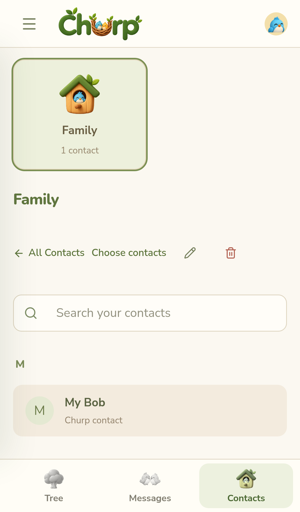
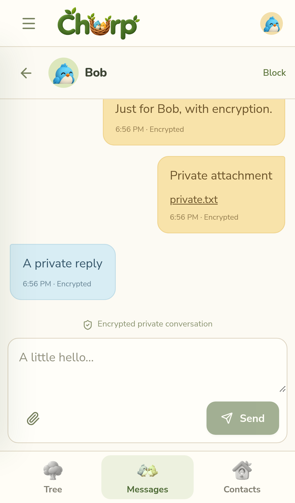

# Personal messaging: delivered first phase

The web/Home Screen app now has exactly **Tree / Messages / Contacts**, in that order. Normal launch opens Tree; a `?conversation=<id>` deep link opens its private conversation, and existing Nest and invitation links remain compatible. The existing optional Branches, inline expansion, pins, unread/urgent eggs, pets, profile settings, polls, RSVPs and assignments stay under Tree. Account settings and Invitations remain accessible without adding tabs.

## Contacts and Birdhouses

Contacts are personal and independent of a selected Tree. My Birdhouses appears before the alphabetical contacts list. A contact may belong to several Birdhouses; deleting a Birdhouse retains its contacts. Contacts can be added, edited, deleted or removed in bulk by their owner only. Phone numbers are normalized with libphonenumber-js, using a selectable country for local-format numbers, and deduplicated by owner and E.164 number. These tables do not create a chat, Tree membership or Nest membership.

Import is deliberate. A supported browser can open its native contact-selection API following the user's button press. CSV (`name,phone`) and vCard (.vcf) files and manual entry are fallbacks, including on browsers without a phone contact picker. The file is parsed locally; users review/check entries before the selected rows are uploaded. Invalid rows are reported/skipped in the preview, duplicate numbers are retained once, files are limited to 2 MB and imports to 1,000 entries. vCard import supports folded lines, FN names and TEL numbers; unusual proprietary export encodings may need conversion to CSV. Phonebook access is never automatic.

A contact can be explicitly linked to a Churp member from a shared Tree. Current accounts do not have verified phone numbers, so numbers/names are not automatically matched to Churp accounts and do not establish SMS consent.

## Private conversations

Messages contains only two-participant conversations. New Message chooses one Churp member from a shared Tree; a later loss of Tree membership does not erase an existing personal conversation. Tree/Branch/Nest admins cannot read other users' private conversations or attachments through the APIs. Blocking is participant-controlled and prevents both directions from sending while retaining history; only the blocking participant can remove their own block.

Private text and attachments reuse the existing approved-device identities, managed vault, personal recovery and self-managed key transitions. They use a separate signed `private-send` operation and `private-message` envelope, binding conversation, sender, nonce, roster and files. Private conversations are never hidden two-person Nests. Ciphertext and per-message file links are stored separately; attachment access explicitly checks the two participants. Both clients decrypt old/current messages with the existing historical key archive. The label records protection at send time: E2EE requires both participants to have self-managed keys with no active managed-vault entry. The default managed mode remains recoverable by Churp and must not be advertised as E2EE.

Text is limited to 10,000 characters and attachments follow the existing 15 MB / five-file limits. Messages paginate in batches of 100, update live, show unread counts, and mark displayed messages read while visible. Generic private-message push payloads contain no text and use the private-conversation deep link. Persistent SQLite data survives restart; explicit sign-out/recovery behaves as for Nest messages. Private-message editing and deletion controls are not included in this first private-chat UI.

## Send Individually: in-app delivery only

Messages → Compose offers New Message and Send Individually. A Nest admin also has About this Nest → Send Individually; the server authorizes the source roster and excludes the sender. The same Members / Contacts / Birdhouse chooser supports deselection and additions, deduplicating overlapping Churp users. A composition is reviewed with a channel breakdown and explicit send confirmation. Each eligible person receives an independently encrypted message in their own two-person conversation, and cannot see the other recipients. Phone-only/unlinked contacts are listed as unavailable, never reported as sent.

Per-recipient results distinguish Sent, Failed and Unavailable. Here, Sent means stored in the recipient's Churp conversation, not read or carrier-delivered. Retrying a failed/uncertain request while the results flow remains open reuses its saved ciphertext and message nonce, and server uniqueness prevents a successful recipient from receiving a duplicate. This phase does not yet provide a persistent broadcast-job dashboard or resume an unfinished batch after reloading/closing the composer. Such durable orchestration belongs to the SMS/broadcast follow-up.

## Invitation policy approved for this phase

Tree members can create Tree invitation links/QR/short codes using the existing invitation service. Tree admins and Branch admins issue immediate-join Tree links. Ordinary members issue links that require approval. Accepting one records a pending membership request; the applicant gets no Tree/Nest access until a Tree or Branch admin approves. The applicant sees a pending state in Invitations. Reviewers see membership requests there with Approve/Decline. Reviews are server-authorized, persisted and single-decision. Approval grants Tree member access only, not Branch admin rights or private Nest membership.

Existing pre-migration admin links retain their immediate-join behavior. All share formats use the same genuine seven-day invitation and preserve QR/short-code behavior. Admin links become unusable if the creator loses the required admin authority; member links require the inviter to remain a Tree member. Nest links remain Nest-admin-only and require existing Tree membership. Neither member nor admin Tree links bypass private-Nest invitations or encrypted history boundaries.

## Deferred and externally dependent

No cloud SMS, billable texts, provider callbacks, native SMS composers, automatic phone matching, subscription billing or paid invitation-footer exemption is enabled. There are no SMS provider credentials to configure for this phase. Later work includes provider choice/registration, genuine consent/STOP/HELP, inbound ownership, costs/budgets, durable per-recipient broadcast jobs, subscription entitlements, native app shells and actual iOS/Android testing. Resend remains email account recovery only. No real SMS is sent by development or tests.

The review draft remains in NAVIGATION-MESSAGING-REVIEW.md as historical planning context; these delivered choices supersede its open recommendations.

## Fictional pilot demo

The explicit seed creates a new isolated 300-member fictional congregation, Branches, Nests, one personal Birdhouse and linked fictional contacts. It adds no real phone numbers or plaintext chat history. It refuses production/Railway, requires an opt-in environment variable and a fresh `/tmp/churp-demo-*` directory, and never runs on startup.

```sh
CHURP_DEMO_SEED=1 node scripts/seed-personal-demo.mjs --data-dir /tmp/churp-demo-pilot
DATA_DIR=/tmp/churp-demo-pilot npm run dev
```

Demo login: `demo_owner` / `Churp demo only!`. Use only on an isolated local development server; never point Railway at demo storage.

## Validation

`npm run check` covers owner isolation, E.164 deduplication, atomic imports, overlapping Birdhouses, two-participant encryption, attachment permissions, block ownership, idempotent send retries, persisted history and membership approval. The secure Playwright personal workflow covers all three tabs, linked contacts, Birdhouses, encrypted replies/files, recovery-compatible key rotation, private deep links, Nest-admin individual sends, approval, selected CSV/vCard imports, desktop and phone-size layouts. Existing Nest/encryption flows are regression checked. Browser emulation does not prove iPhone contact-picker availability, real keyboard behavior or actual system push delivery; validate those on real phones.

## Screenshots from the working app

Fictional browser-test accounts, not production conversations:

| Contacts and Birdhouses | Encrypted private chat |
| --- | --- |
|  |  |

[Generated navigation artwork](../public/brand/navigation/README.md).
