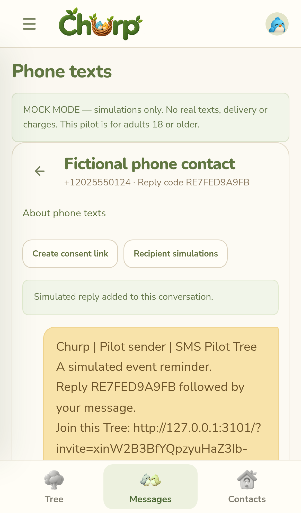

# Archived provider-texting pilot

Provider texting has been retired. The current flow is [Churp-first messaging and personal-phone drafts](PHONE-DRAFTS.md). Production ignores the activation settings below and cannot dispatch provider texts. The remaining content records the previous implementation for historical reference and isolated tests.

# Churp phone texting — mock pilot and Twilio adapter

## What is delivered

Messages → **Phone texts** is a separate, visibly labeled SMS workspace. It reuses saved Contacts and Birdhouse memberships; it does not convert encrypted private messages or create artificial Nests. Adult users choose a saved US phone contact and a Tree, then create a conversation. **Text several contacts** selects phone contacts from any personal Birdhouse, with a maximum of 50 per batch. Duplicate contact numbers collapse into the same owner/Tree/phone thread. **Send Individually → Text phone contacts instead** opens this workspace; in-app fan-out remains a separate encrypted operation. One mixed in-app/SMS batch and native personal-phone texting are not included in this phase.

Each outgoing text includes `Churp | sender | Tree`, the entered text, a stable conversation reply code, a genuine expiring Tree invitation, and STOP/HELP instructions. The invitation comes from the existing invitation service. Members' links still require Tree/Branch approval; admin links retain their existing behavior. Every send and dispatch checks membership, adult eligibility, scoped Nest-admin rights if entered from a Nest, invitation validity, consent and global opt-out. There are no paid entitlements yet, so the app invitation cannot be removed. Its promotional classification must be addressed in provider approval and consent.

The review displays the complete final text, per-recipient eligibility, GSM-7/Unicode segmentation, a configured cost estimate, and explicit confirmation. Churp does not silently send private-chat ciphertext or decrypt an internal conversation for SMS. Text-only SMS and replies are stored encrypted at rest using the existing managed vault, with independent authenticated contexts. Phone numbers and routing/consent/delivery metadata remain visible to the server. SMS is not E2EE, including when the sender's Churp account uses self-managed keys. MMS attachments are not sent or fetched in this version.

## Current Railway setup

The owner has configured:

```
SMS_MODE=mock
TWILIO_ACCOUNT_SID=<enter directly in Railway>
TWILIO_AUTH_TOKEN=<enter directly in Railway>
TWILIO_MESSAGING_SERVICE_SID=<MG… for Churp Texting>
TWILIO_FROM_NUMBER=<purchased US number in +1 format>
```

**Leave SMS_MODE=mock.** This mode never calls Twilio, even when real credentials exist. Results say mock sent/mock delivered/mock received; no carrier delivery is claimed and no real consent is established. Test accounts can create simulated adult consent or open the real-shaped, clearly simulated web enrollment form. STOP, START, HELP, JOIN and reply-code routing can be tested through **Recipient simulations**. A successful simulated send is not promoted into a live send after a mode change.

Absent/unknown SMS_MODE disables the workspace's send controls. `live` alone also leaves sending unavailable. Existing accounts, encryption keys, Tree/Nest workflows and private chats are retained.

## Consent and suppression

A sender generates a high-entropy, seven-day enrollment link from a phone conversation and shares it separately with its intended adult recipient. Churp never sends an unsolicited SMS asking for consent. The public page `/sms/enroll/<token>` names the actual sender and Tree and masks the stored number. It requires the matching phone number and four separate unchecked confirmations: adult/phone control, service messaging, promotional invitation, and terms/privacy. Disclosures include frequency, rates, STOP/HELP, optional consent, and policy/support links. The operator is Dustin Fausett, operating as Churp; contact is churptree@gmail.com.

Submitting the form records pending evidence, disclosure version/text and time; it does not activate messaging. The recipient must send its one-time `JOIN <code>` from the matching number. A signed Twilio webhook establishes phone control in live mode. Mock confirmations stay in the mock consent namespace. Consent is per sender/Tree/phone; a saved contact, Tree membership or another sender's enrollment does not establish it.

STOP and supported equivalents suppress that phone globally for the current mode, revoke all its consents and suppress unsent queued messages. State survives contact deletion/reimport and server replacement. START/UNSTOP only clears transport suppression; it does not restore every sender's consent. The recipient must enroll again for each program. Separate `mock` and `live` consent and suppression records prevent simulations from granting or withdrawing real permission.

The pilot permits adult senders and recipient enrollment requires adult attestation. Linked youth or incomplete Churp identities are blocked. An unlinked external phone user's age is not independently verified; the form is not proof of age or guardianship. Under-18 external messaging and SMS parent supervision are not implemented. The app's internal youth protections remain separate and cannot be represented as automatically covering arbitrary phone numbers.

## Replies and webhooks

A recipient must begin a conversation reply with the R-code included in that conversation's messages, e.g. `R0123456789 Yes, Saturday works`. A plain `yes` is never assigned based on last sender or phone alone. Uncoded/unrecognized content is not persisted or exposed to unrelated senders; the response explains how to use the code. STOP/START/HELP/JOIN are processed before ordinary routing. Duplicate inbound MessageSid values are idempotent. Media URLs are never fetched.

After the endpoint deployment, configure the Messaging Service's incoming-message webhook (POST) to:

```
https://app.churptree.com/api/sms/webhooks/inbound
```

The adapter supplies its status callback per send:

```
https://app.churptree.com/api/sms/webhooks/status
```

The endpoints validate Twilio's HMAC-SHA1 signature against the exact configured APP_URL path, AccountSid, and the expected destination number. Do not use an HTTP Railway internal address, a different hostname, trailing slash or extra query parameters when configuring them. Callbacks use Twilio's form encoding, not browser authentication. They reject traffic while live configuration is unavailable. Configure service-level handling consistently with the endpoints; avoid conflicting legacy webhooks or duplicate keyword replies. If Twilio Advanced Opt-Out is enabled, its behavior and OptOutType events must be tested and matched to Churp's state before activation; this release processes the actual Body keywords and returns TwiML responses.

The single configured From number is explicitly supplied along with the Messaging Service SID. Keep only the intended sender number configured for the pilot. Mock inbound/delivery controls are authenticated, owner-scoped and unavailable in live mode.

## Durable queue, delivery and budgets

A batch has an owner/client nonce and request hash. Repeating an identical request returns the same durable job; changing it conflicts. Results remain in **Recent text batches** after closing/reloading the app. Queued → dispatching → submitted means Twilio accepted the API request; sent and delivered come from signed status callbacks. Delivered does not mean read. Older callbacks cannot downgrade delivery. Callbacks arriving before the API response are held by provider SID and applied once the message is linked.

A crash during dispatch or network/5xx/invalid provider response leaves an **unknown** submission. It is not automatically resent. An operator must reconcile it with Twilio; there is no automatic unknown-state resend/reconciliation UI. Definitive 4xx rejection is retryable from the thread, with permissions and consent checked again. Remaining queued items can be canceled. A STOP or revoked permission while a provider request is already in flight cannot recall that request.

Default conservative rolling-24-hour reservation limits:

```
SMS_DAILY_SEGMENT_LIMIT=200
SMS_SENDER_DAILY_SEGMENT_LIMIT=50
SMS_DAILY_BUDGET_CENTS=1000
SMS_ESTIMATED_SEGMENT_COST_CENTS=5
```

Every eligible queued attempt reserves its estimated segments/cost atomically. Retries reserve again. Canceled/failed reservations are conservatively retained for the rolling window; this is an upper-bound attempt budget, not billing reconciliation. The estimated rate is configurable and is not a current Twilio price quote. It does not include number rental, registration, inbound charges or provider/TwiML-generated keyword responses. Also set provider account spending alerts/limits before live use. No real billing information is fetched or charged by mock mode.

## Live activation remains a separate, uncompleted step

The REST adapter and signed webhook handlers are implemented and tested with injected transports; no real text has been sent during development. Actual carrier delivery is unverified. The purchased local number still needs the appropriate registration, and a single platform brand/number cannot be assumed to cover unrelated organizations. Follow the human provider/compliance review for the exact model.

Live mode additionally requires all of these operator settings:

```
SMS_MODE=live
SMS_LIVE_APPROVED=true
SMS_PILOT_TREE_ID=<one approved pilot Tree id>
SMS_LIVE_SENDER_IDS=<comma-separated approved adult Churp user ids>
```

`SMS_LIVE_APPROVED` is an operator readiness assertion, not proof of carrier approval. Do not set it before the number/service, real consent and keyword handling, sender identity, organizational scope, policy pages and budget are verified. The first live scope is deliberately one Tree and an explicit sender allowlist; mock development supports separate conversations across Trees. Real credentials, valid +1 US numbers, HTTPS APP_URL and service/from configuration are also required. Tests never invoke a real Twilio transport. Flipping the mode cannot reuse simulated enrollment, messages or callbacks as live evidence.

## Verification

`npm run check` includes tests for segment counting, zero-network mock mode, ownership, US-only contacts, adult restrictions, real invitation scoping/revocation, consent evidence and separate checkboxes, double opt-in, global STOP and fresh re-enrollment, reply isolation, durable nonce handling, encrypted storage, rolling budgets, restarts and uncertain send behavior. Adapter/webhook tests inject HTTP responses and sign fixture payloads; they verify exact signature URLs, account mismatch rejection, callback ordering and inbound deduplication.

`npx playwright test -c playwright.encryption.config.js e2e/sms.spec.js` exercises the browser's mock enrollment, review, queue, delivery/reply simulations, opt-out and persisted batch results across desktop and phone-sized layouts. These are browser simulations, not real carrier tests or native iOS/Android texting.

## Preview


