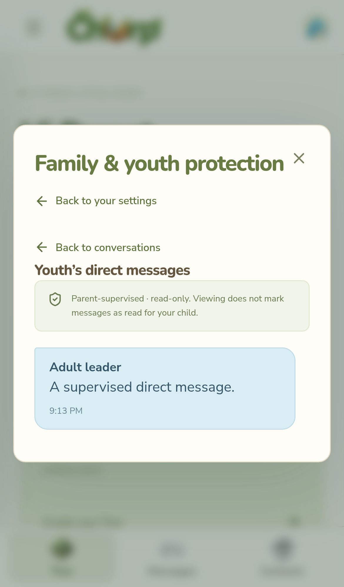

# Protected youth accounts and supervised direct messages

All new username/password registrations require a valid date of birth. Google accounts and accounts created before this release must record it before continuing. The date is private account data, never returned in Tree member directories. It is immutable through ordinary account/profile APIs. Calendar age is evaluated on the server in UTC on every authorization; an account stops being protected on its 18th birthday (March 1 for February 29 births in a non-leap year).

Date of birth is self-reported. This implementation is not identity verification, independent proof of guardianship, or a verified parental-consent service. A code exchange confirms control of two accounts and an adult's explicit parent/legal-guardian attestation. These distinctions matter when operating a service for children, particularly those under 13; a verified parental-consent process and applicable privacy/legal requirements must be assessed before a public children's launch.

## Setup and account linking

1. A parent aged 18 or older signs in to their own account and opens **Your corner → Family & youth protection**.
2. **Create parent invitation code** creates a single-use, hashed-at-rest code, valid for 24 hours. Generating another invalidates that parent's previous unclaimed code.
3. The youth enters the code on their setup screen. The parent sees the child's name and username and must explicitly confirm that they are their parent or legal guardian.
4. A youth needs at least one active parent and can link a second. Either parent can approve a conversation for their own child. No Tree membership or admin role is needed for family linking.
5. If earlier direct messages need to be shared, the youth's unlocked device must select **Prepare messages & continue**. Access remains gated until migration finishes for all active parents. Interrupted work resumes from the remaining messages, without duplicate delivery.

A pending code/link does not grant message access. The youth can cancel a pending link but cannot remove an active parent link. A parent can remove their own link; removing the last parent returns the youth to setup. Removing a parent also invalidates adult-contact approvals made by that parent, so a remaining parent must review them again. An adult child is no longer subject to parental access or approvals, even if the old link record remains for account history. There is no automated age-correction, family-dispute or guardianship-verification workflow in this release; do not edit dates casually to bypass the controls.

## Private conversation approval

One-on-one messages between a youth and an adult aged 18 or older require approval from an active linked parent, regardless of who initiates the conversation. A youth's own active linked parents are already permitted contacts. Youth-to-youth conversations need approval from a parent in each family and are supervised by both families.

The New Message chooser labels contacts needing approval. Choosing one opens a supervised first-message composer. One first message, including attachments, goes to linked parents for review before the other participant can read it. Parents review the full first message in Family & youth protection and can approve or block/unblock the conversation. Either linked parent can approve for their own child; in a youth-to-youth conversation, the other family must also approve. Approval applies to that pair of accounts across Trees. Approvals do not override a participant's block.

A shared Tree lets a fully set-up member request private contact. It no longer grants immediate adult-to-youth messaging or permission to link that youth's Churp account in Contacts. Contact creation/edit/import all enforce the same restriction. Manually saving a phone number is still personal address-book data; it does not match or grant access to a Churp account. Incomplete accounts are excluded from the private-message chooser.

**Send Many Individually is subject to the same rules.** The Nest-source recipient list excludes unapproved/incomplete accounts; other recipient lists allow one first message for parent review and mark already-pending or blocked contacts unavailable. The server independently checks permission for every actual send, including old clients, guessed conversation IDs, saved drafts, and retries. Admin roles never bypass parent approval. Removing/revoking approval or changing parent recipients during an asynchronous send invalidates stale authorization/audiences.

## What parents can see

Parents open **View [child]'s direct messages** in Family & youth protection. It lists the child's one-on-one conversations with anyone, with readable messages and attachments, including migrated earlier messages. Parents can remove content from participant views or block/unblock the conversation while retaining the original for review. They cannot send as the child, mark the child's messages read, or clear the child's own block. A parent who is an actual participant in a separate parent–child conversation retains their normal rights as that participant.

Both ordinary chat participants see a **Parent-supervised** notice. In a youth-to-youth chat, active parents of either youth can read the entire conversation. The supervisor view does not grant Tree or Nest membership. Nests retain their existing membership, join-history, admin, encryption and file permissions; no guardian recipient is added to a Nest's roster by this feature.

Parental API access ends when the link is removed or the child turns 18. Already downloaded/decrypted content cannot be revoked. Future messages omit former guardians from their encryption audience. A fresh sign-in on a parent account follows its existing managed/self-managed key recovery rules.

## Encryption and historical migration

No child's account private key is given to a parent. Sharing that key would also expose Nest history. Instead:

- Approved direct messages are encrypted to the two conversational participants plus every active linked parent of each protected participant. A pending first message is encrypted only for its sender and the linked parents; approval wraps its unchanged encrypted contents for the other participant. The server validates the exact recipient keys, signed conversation context, approved device, current permissions, and key/parent audience again before insertion.
- Per-message recipient records authorize guardian access to ciphertext and encrypted attachment bytes. Parent review routes require an active link to a protected participant, and approved devices are required to fetch message ciphertext. Read, send, block and roster endpoints still require actual conversational participation.
- Historical sharing runs on the child's approved device using current or archived private keys. It decrypts the historical session key and wraps it for each parent's public key. The original authenticated encrypted data packet and original sender signature remain unchanged. The server verifies a child-signed sharing proof, exact parent recipients and byte-equivalent encrypted contents before saving a guardian copy. Message text and attachment descriptors are never uploaded in plaintext.
- The child signs only a historical-sharing authorization, not a replacement message claiming to have been written by the original sender. Original participants continue to receive the original ciphertext. Parents receive the applicable guardian copy or the new message's original multi-reader ciphertext.
- Self-managed accounts stay self-managed. If an earlier identity is unavailable, migration stops with recovery instructions; it never silently replaces a key or skips inaccessible history. The setup gate remains until the original device/key is recovered and migration completes.
- Supervised chat bubbles use the Parent-supervised label rather than implying that only the two participants can decrypt them. Nest shields remain based solely on actual Nest members' key custody.

Long-term identity encryption still lacks forward secrecy, as documented in ENCRYPTION.md. A modified malicious client can sabotage ciphertext readability, as with existing encrypted sends; structural recipient validation is not proof that the sender used a correct shared session key. These account controls cannot prevent people from exchanging details off-platform, lying about age, or photographing messages.

## Verification

`npm run check` includes API tests for date boundaries, setup gating, two-parent confirmation, private-contact/import restrictions, parent approval/revocation, exact recipient encryption, guardian read-only access/files, isolated Nest access, history authenticity, stale audiences, restart persistence, automatic adulthood and link removal. Existing fixtures now explicitly register adult dates; production has no test-mode age bypass.

`npx playwright test -c playwright.encryption.config.js e2e/family.spec.js` exercises real youth signup, parent confirmation and request review, supervised read-only chat, revocation, and a self-managed pre-release account's age/history migration on desktop and phone-sized Chromium browsers. Native iOS/Android apps and independent parental verification are not included.

Database changes are additive. Existing messages, users, managed vault files, recovery backups, attachments and Railway volume contents remain in place. No email/SMS provider, new secret or external verification service is required to deploy this release.

## Preview

## First-message review and parent moderation (October 31, 2026)

New adult–youth conversations, in either direction, allow one first message for review. New youth–youth conversations require approval from one active parent in **each** family. The youth's own linked parents remain permitted contacts. Pending first messages are encrypted for the sender and the linked parents; the other participant is excluded from the initial ciphertext and cannot access its text, attachments, reactions, previews or unread badge. A second message waits for approval.

**Family & youth protection → Review conversation** displays the full first message and attachments. Approval wraps the existing authenticated message session key for the participants without disclosing the child's account key or changing the sender's original signed contents. Delivery copies remain withheld until all required family approvals are present. Every current linked parent remains a reader of later messages. A parent review never marks the child's messages read and offers no child-send control.

Parents can block and unblock a conversation. A parent block stops new sends and hides that child's conversation history, attachments and shared-item access; parents retain review access. A child's own block remains independent and is not cleared by parent unblocking. Parents can also hold a message and choose **Remove from conversation**: participants see a removed-content placeholder and lose attachment access, while parent review retains the original content. Previously downloaded copies cannot be recalled. Parent powers and blocks stop applying once the child turns 18.

Member lists in Trees, Nests and the Tree contact picker can open direct conversations, including protected accounts. Nest member counts use the branded member artwork and open the actual Nest roster. Self-notes are allowed; youth self-notes retain linked-parent access.

## Private edits and deletion

Authors can edit their own approved, unblocked private messages using signed, versioned updates that preserve attachments and current authorized readers. First messages awaiting parent approval cannot be edited during review. Edits do not send another push alert. Deleting replaces a message with a tombstone for participants and removes participant access to its attachments unless another authorized message shares the file.

For supervised conversations, deleted content remains readable to linked parents. Earlier edited versions are retained encrypted with their original signatures and per-parent copies. Hold an edited message in parent review and choose **View edit history**. Active family links and per-version reader permissions still apply. Parents cannot send or edit as the child. Already downloaded content cannot be recalled.
