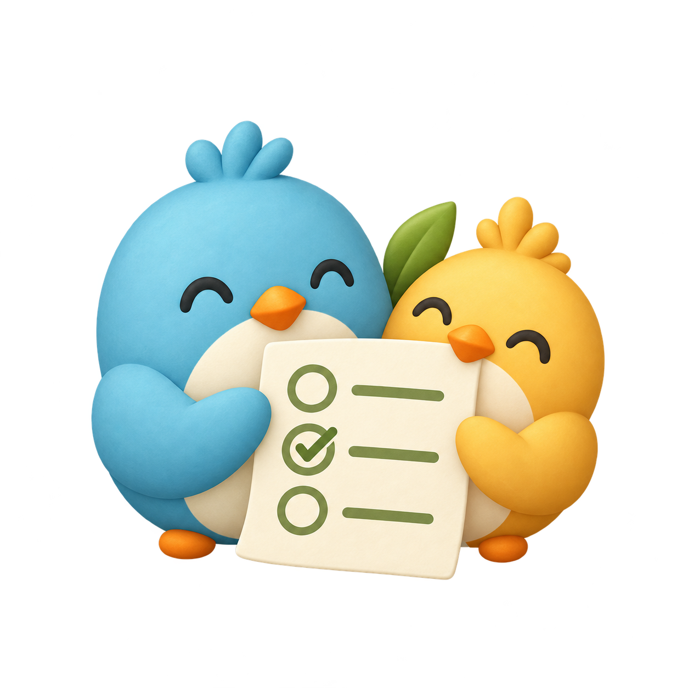
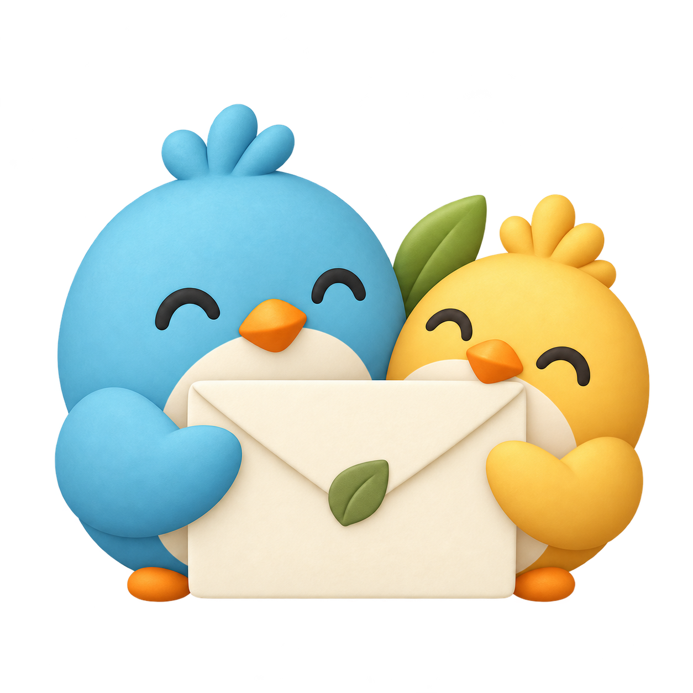
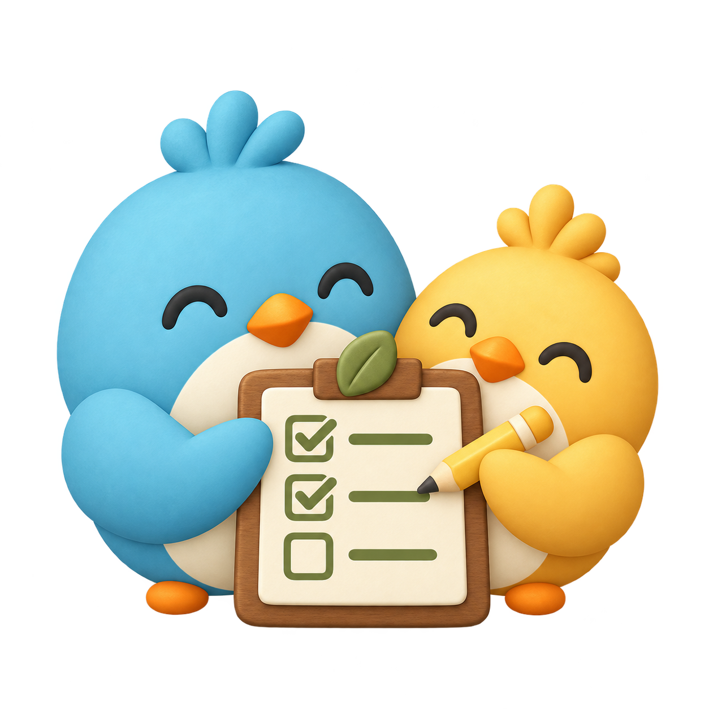
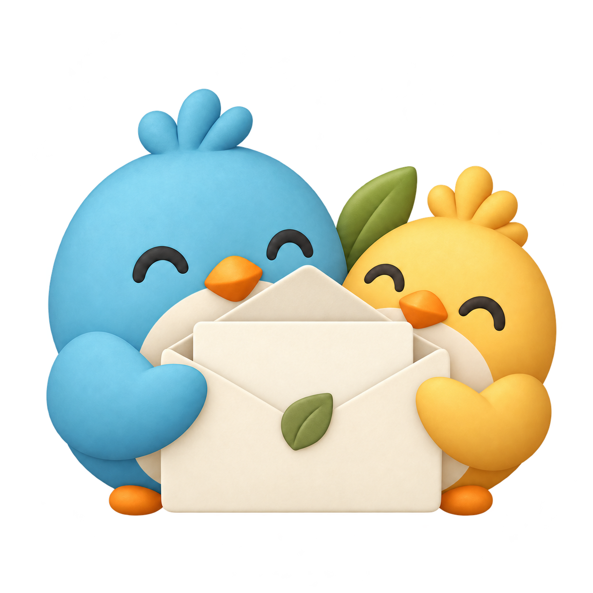
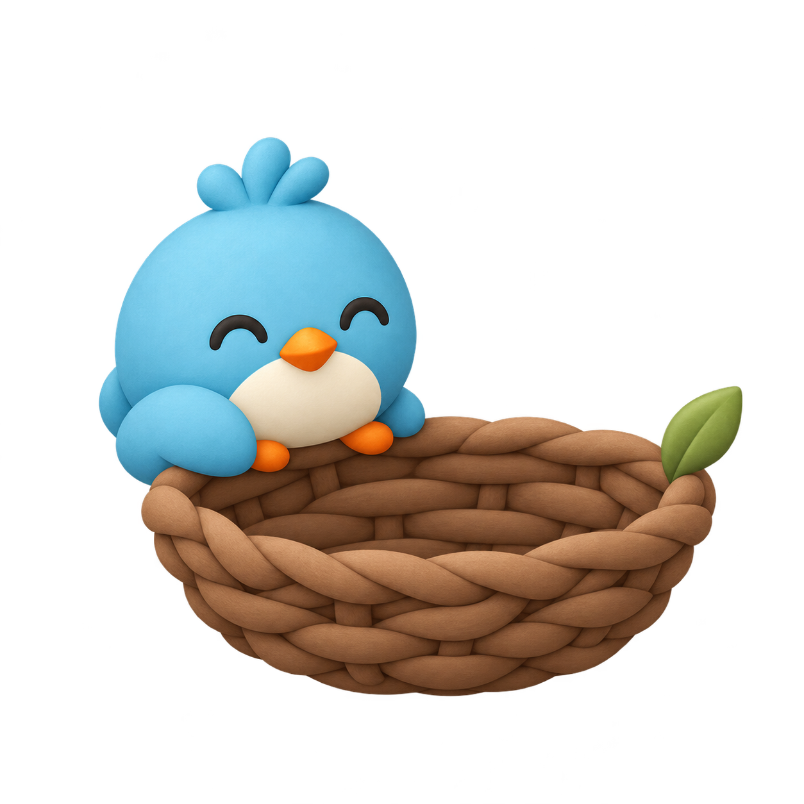
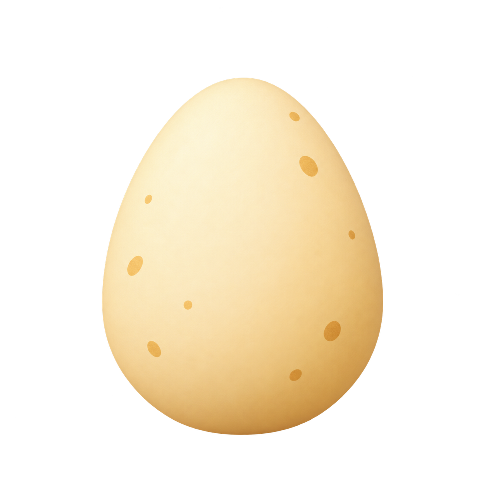
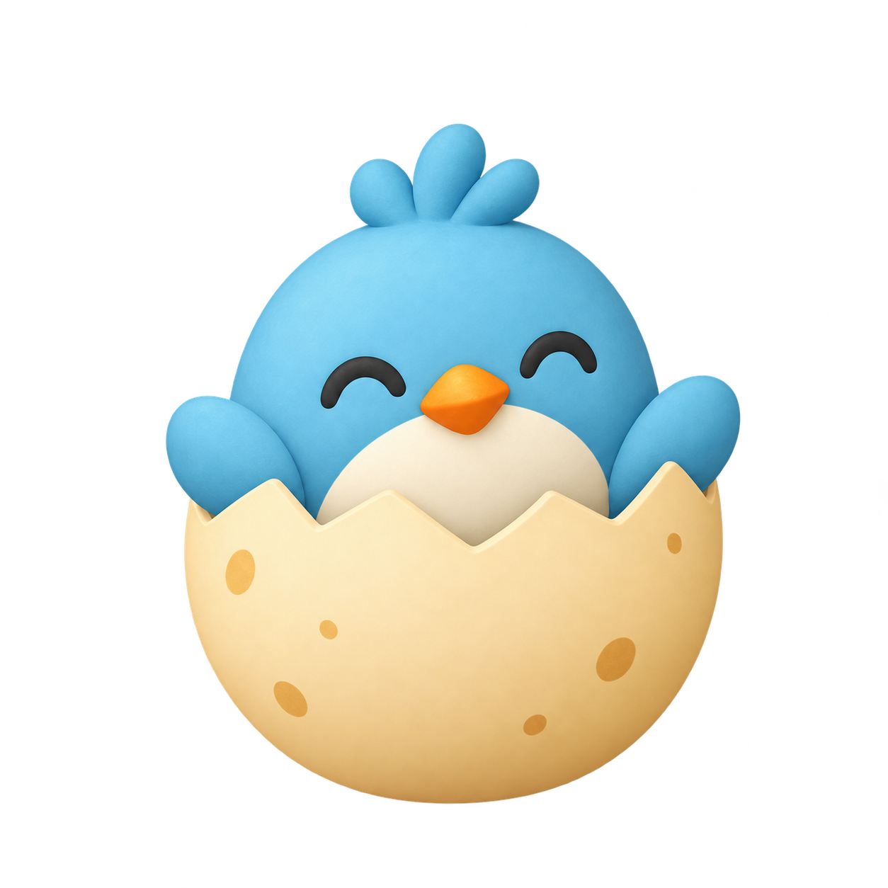
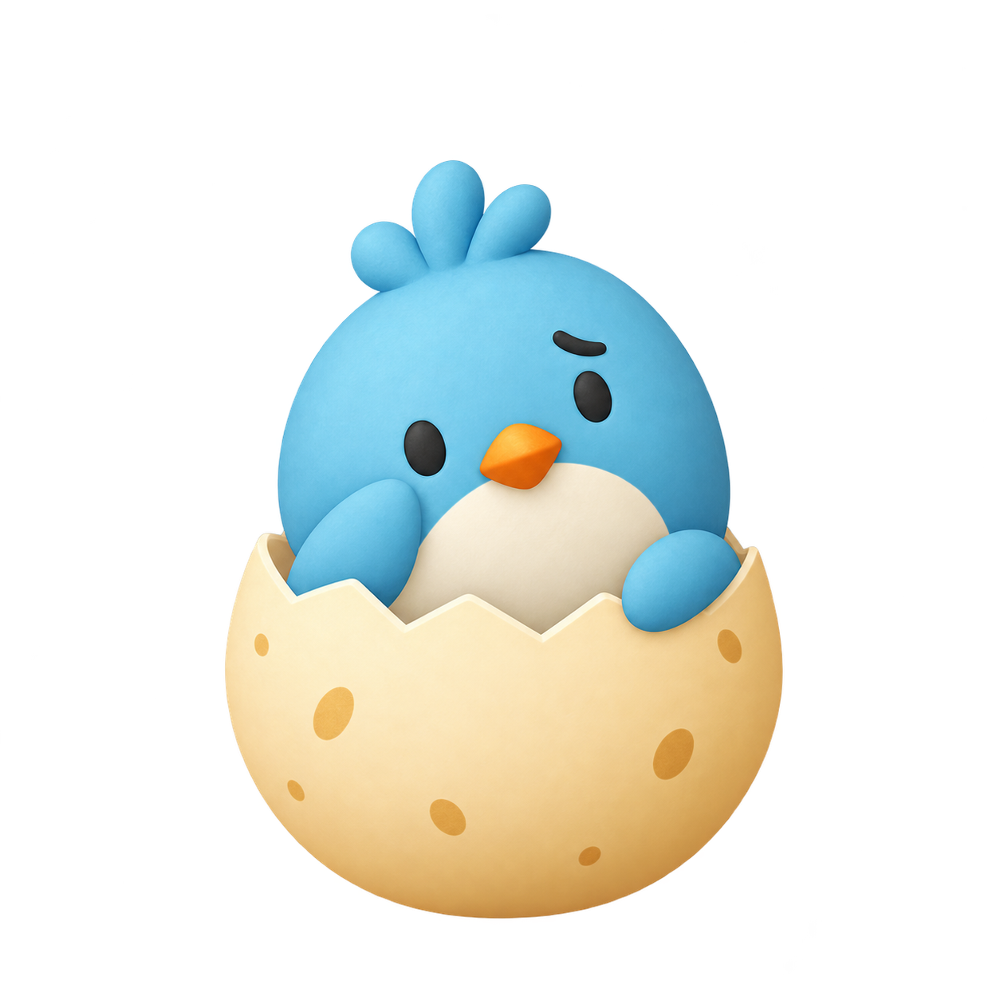
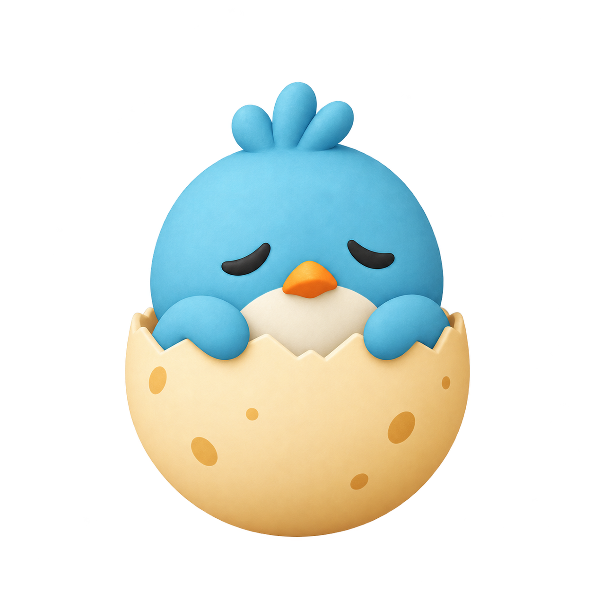

# Churp activity illustrations

The same blue-and-gold bird pair carries every activity, with cream paper, olive leaves, warm walnut props, simple expressions and soft matte shading. Transparent square canvases keep the illustrations consistent in chat cards, the + menu and the shared-items library.

| Poll | RSVP | Assignments |
| --- | --- | --- |
|  |  |  |

| Open invitation | Poll answer basket | Answer egg |
| --- | --- | --- |
|  |  |  |

| Going | Maybe | Can’t go |
| --- | --- | --- |
|  |  |  |

All nine PNGs were generated using the logo and the new Poll illustration as visual references. The opened envelope is a reference edit of the closed envelope. Original generated files are retained in the workspace. `src/activityArtwork.js` is the app’s shared asset map; `src/activity-cards.css` coordinates their frames and scale. Older illustration URLs remain available for clients with an earlier app bundle.
