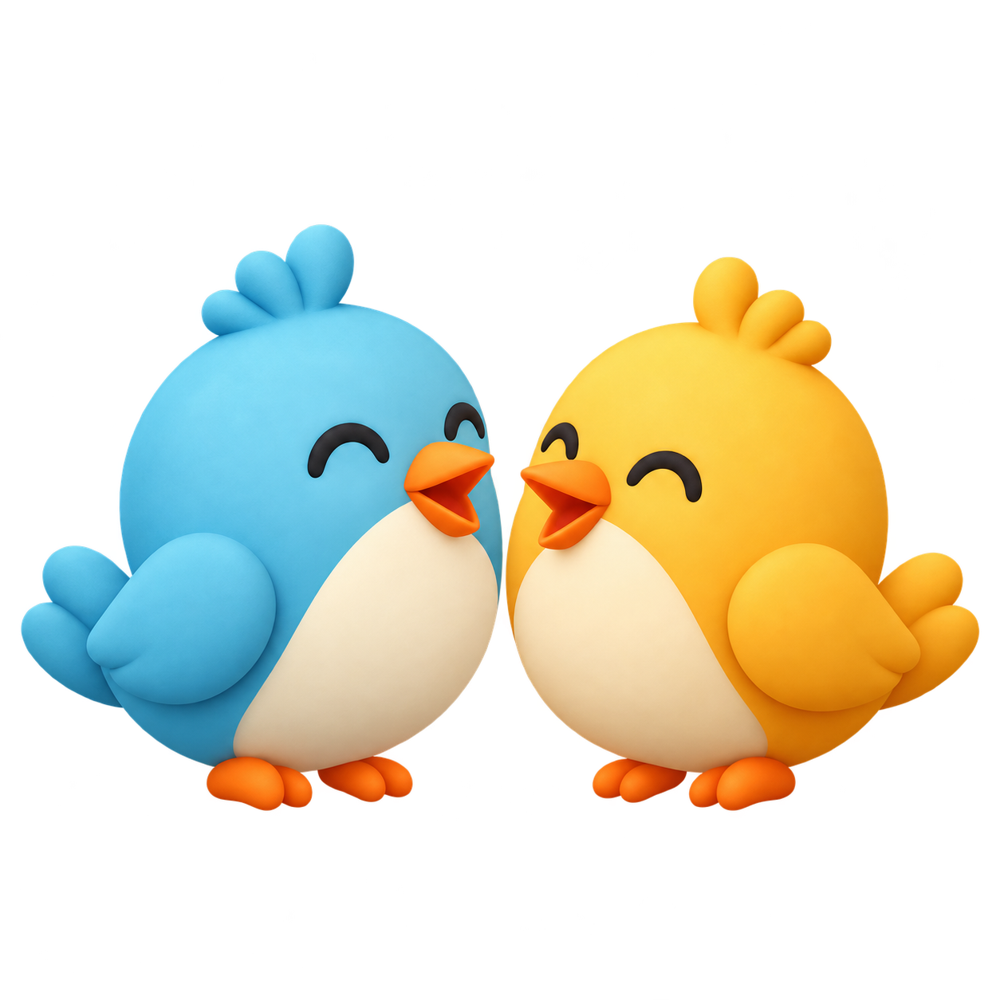
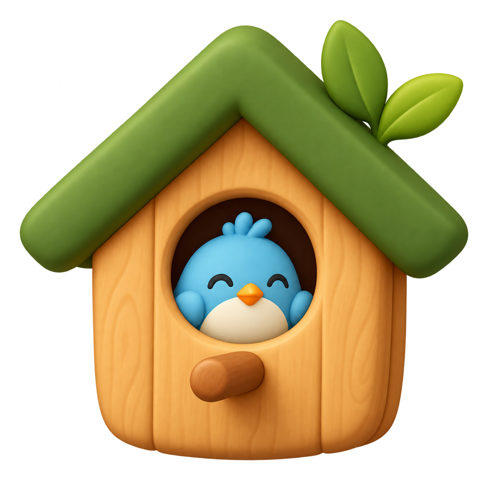
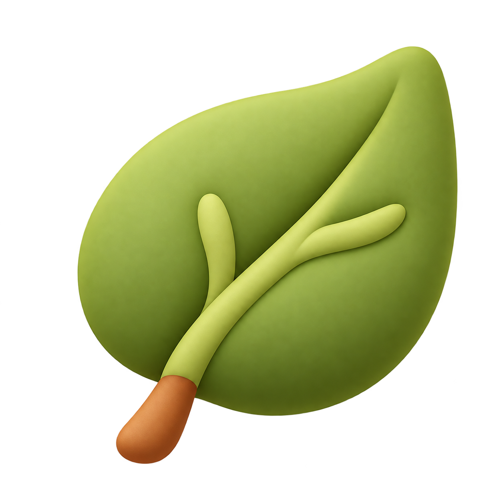
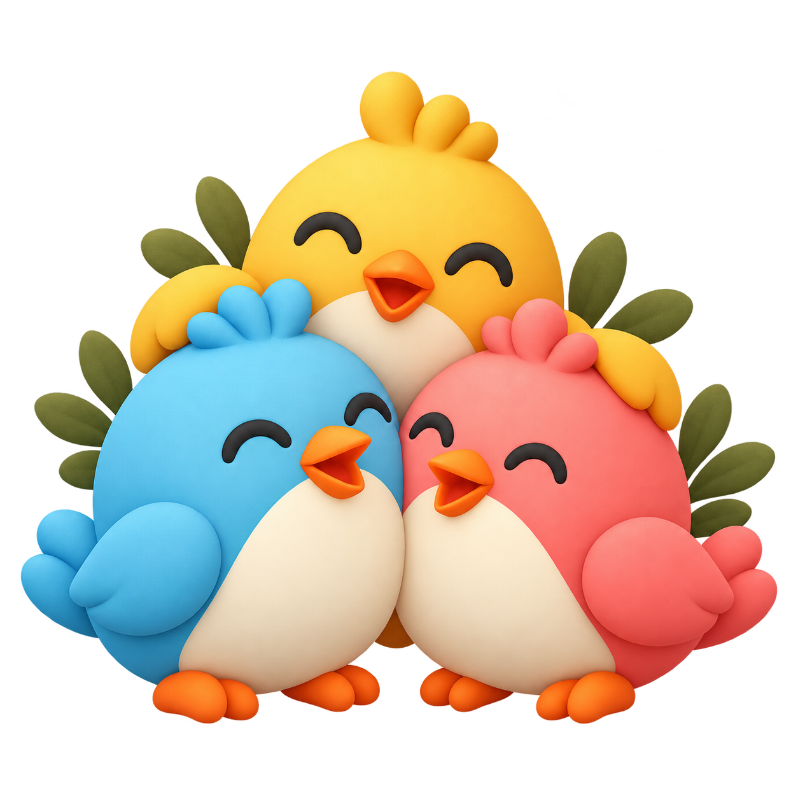
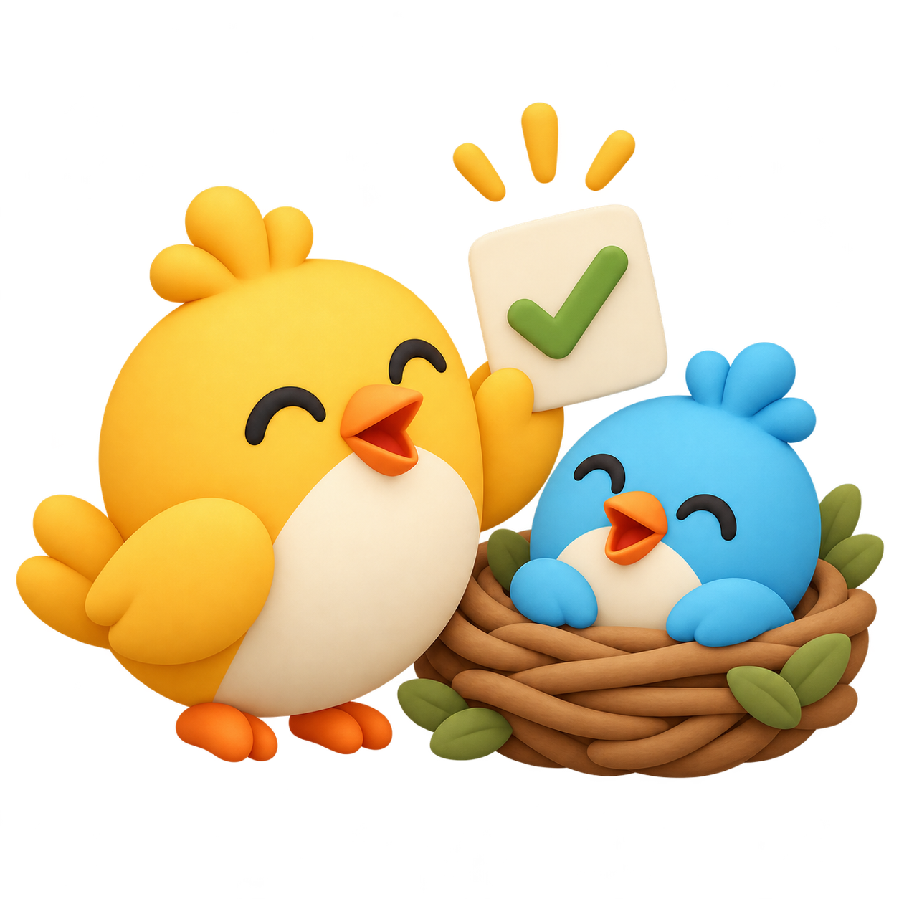
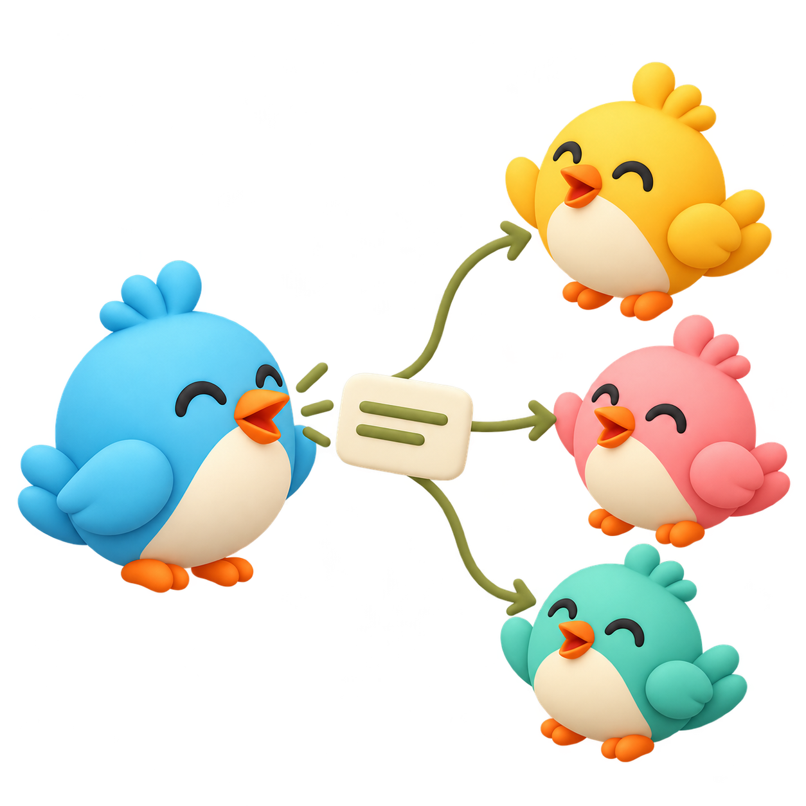
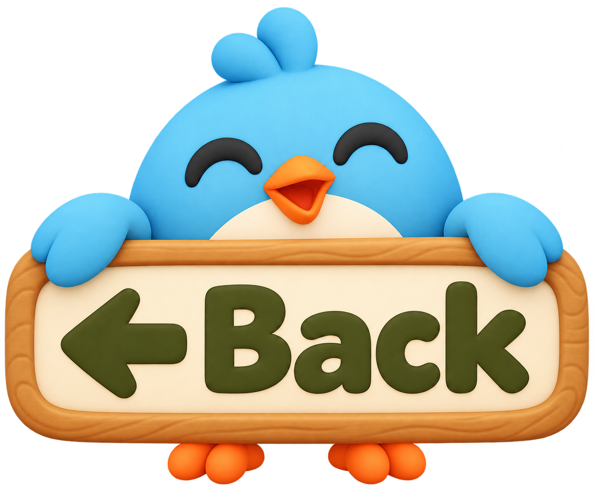

# Churp bottom navigation

The approved tree artwork is reused from `../previews/churp-tree-nest-icons.png`. The two new transparent illustrations were generated using the approved Churp logo as a reference and are used by the real navigation, empty states, Birdhouses and message composer.

| Messages: two birds talking | Contacts: a birdhouse |
| --- | --- |
|  |  |

The original PNGs are preserved. `NavigationArt` in `src/Contacts.jsx` uses a display viewport for the bird pair to remove spare transparent space at tiny navigation sizes. Active icons use an olive tint; inactive icons are subdued. Visible labels and accessible names accompany all three tabs. The source files have no background so they can be displayed on light and dark surfaces without an opaque square.

## Tree menu and compose illustrations

Generated with the existing blue/gold bird artwork as the style reference. Original transparent PNGs are preserved and used in the app.

| Tree details | Members | Creation requests | Send Many Individually |
| --- | --- | --- | --- |
|  |  |  |  |

## Back to Tree

Generated with the approved Churp bird style as a reference. This transparent illustration is the real Back to Tree button in every Nest header, immediately before the Nest avatar. Its sign includes a left arrow and the word **Back**. The original generated PNG is preserved; CSS scales it for desktop and phone headers. The button uses an explicit accessible label and a generous touch target.
